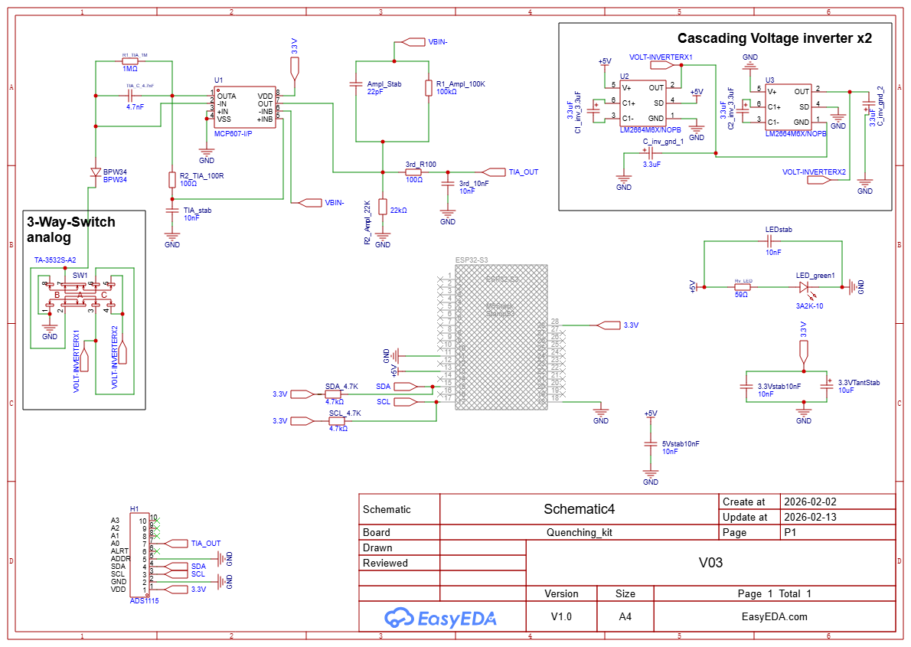
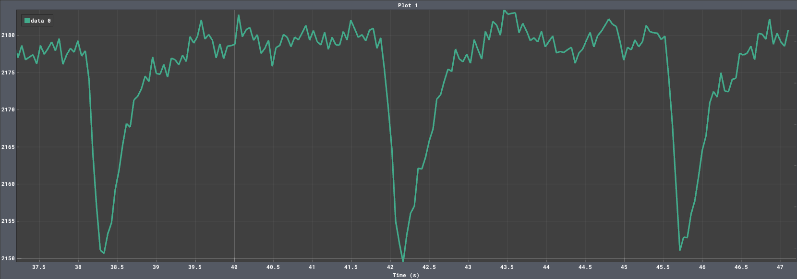
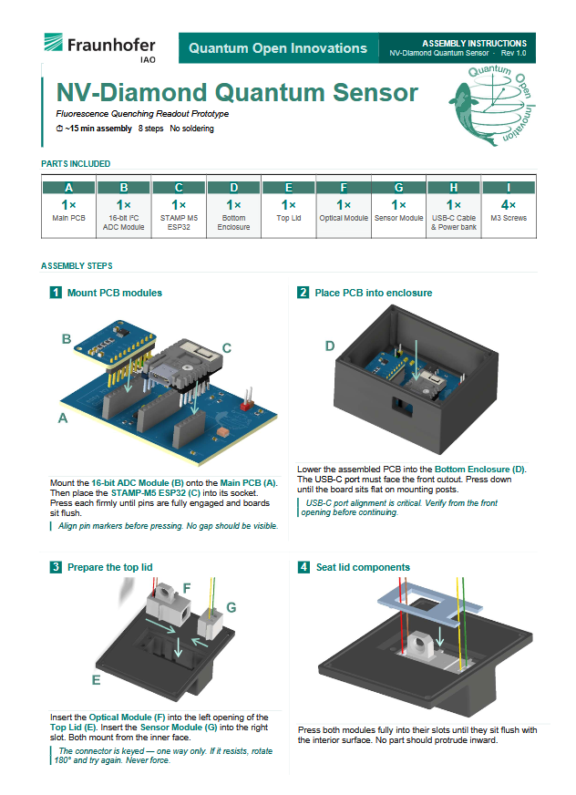
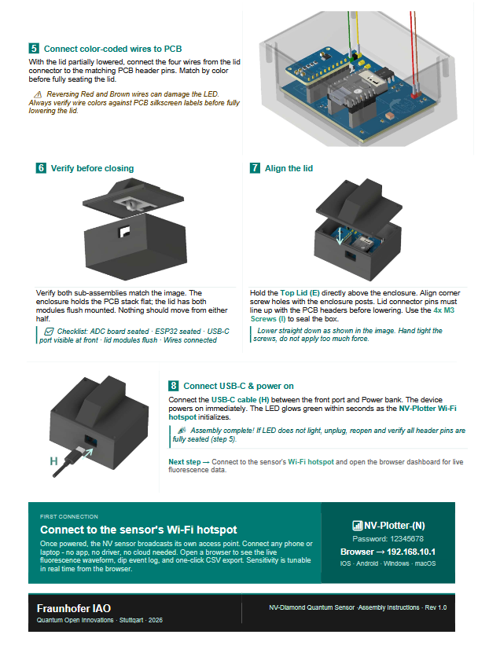

# NV-Diamond Magnetic Field Sensor — Fraunhofer IAO

> Low-cost magnetic field sensor based on nitrogen-vacancy (NV) centers in diamond.
> A green LED excites the diamond, a BPW34 photodiode behind a red filter reads its fluorescence,
> and an ESP32-S3 detects the drop in fluorescence when a magnet approaches
> and streams the signal to a browser over its own Wi-Fi.


---

## System at a glance

<p align="left">
  
  
</p>

<p align="left">
  
  <br><em>Browser dashboard: the signal drops each time the magnet approaches, and red lines mark the detected dips.</em>
</p>

---

## How it works

Green LED (525–532 nm) → NV diamond → red filter (650–750 nm) → BPW34 photodiode → MCP607 transimpedance amplifier → two RC low-pass stages → ADS1115 16-bit ADC → ESP32-S3 → Wi-Fi → browser

A magnet near the diamond lowers its red fluorescence (by 2–3 % in the initial evaluation), and the signal returns to its baseline when the magnet is removed. The readout is all-optical: there is no microwave excitation yet, so the sensor measures fluorescence quenching, not ODMR.

---

## Module gallery

| NV module | Optical module | Main PCB | Test bench |
|:---------:|:--------------:|:--------:|:----------:|
|  |  |  |  |
| Red filter and BPW34 photodiode | Green LED and two collimator lenses | TIA, bias switch, ADC and ESP32 sockets (3D model) | Servo-driven magnet arm |

---

## Hardware overview

| Part | Description |
| ---- | ----------- |
| **NV module** | Red filter film (650–750 nm) in front of a BPW34 PIN photodiode |
| **Optical module** | Green LED (525–532 nm) and two acrylic collimator lenses (f ≈ 30 mm) |
| **Main PCB (rev 5)** | Photodiode bias switch (0, −5 or −10 V from two cascaded LM2664 charge pumps), MCP607 transimpedance amplifier (1 MΩ ∥ 4.7 nF) with an optional non-inverting stage, two RC low-pass stages (fc ≈ 160 kHz), sockets for the ADC and the ESP32 |
| **ADS1115** | External 16-bit I²C ADC: ±0.256 V full scale, 7.8 µV per count, 860 samples/s |
| **ESP32-S3 (M5Stamp S3)** | Averaging, IIR filtering and dip detection; Wi-Fi access point, web page and WebSocket stream |
| **Sensor box** | Black PLA-CF enclosure with 1 mm walls next to the diamond and 4 mm elsewhere; all wiring inside except USB-C |
| **Test bench** | SG90 servo with a printed magnet arm for repeatable magnet passes |

---

## Schematic

<p align="left">
  
</p>

Schematic V1.0 of the main PCB, rev 5 (EasyEDA, 2026-02-13). PDF: [`docs/schematic_rev5.pdf`](docs/schematic_rev5.pdf).

The manufacturing files for rev 5 (Gerber, pick-and-place and assembly BOM) are not part of this repository. The technical report lists every component with its value and purpose, and the 3D board model is in [`Design/Parts/3D_PCB5.step`](Design/Parts/3D_PCB5.step).

---

## Performance results

Measured values and design figures from the documents in [`docs/`](docs).

| Metric | Value | Conditions |
| ------ | ----- | ---------- |
| Fluorescence drop | 2–3 % | Initial evaluation: 15–30 mV drop from a 0.80–1.00 V TIA output, depending on magnet position; fully reversible |
| Control run | No measurable change | Same setup and magnet motion with the red filter but without the diamond |
| Noise at the TIA output | 0.34 mV RMS | ADS1115; 6.6 mV RMS with the ESP32 internal ADC (~19×, ≈ 26 dB) |
| ADC resolution | 16 bit, 7.8 µV per count | ADS1115 at ±0.256 V full scale (production firmware) |
| Processing rate | ~86 steps/s | 860 SPS, 10 conversions averaged per step |
| Dashboard update rate | ~22 Hz | WebSocket, every 4th step |
| Maximum dip rate | 1200 dips/min | 50 ms guard between dips |
| CSV buffer | 2000 samples (~91 s) | Ring buffer in RAM, downloadable as CSV |
| Rotation test | 61.5 rpm mean, σ = 3.9 rpm | Six dips; servo programmed for 58.6 rpm; +4.9 %, consistent with the SG90's dynamics |
| Material cost | ~20 € | Including the ADS1115 and the fabricated PCB |

<p align="left">
  
  <br><em>Repeatable fluorescence dips with the magnet moved by the servo.</em>
</p>

---

## Assembly walkthrough

|  |  |
| - | - |
|  |  |

Eight steps, about 15 minutes, no soldering. Full instructions (Rev 1.0): [`docs/Assembly_instructions.pdf`](docs/Assembly_instructions.pdf).

---

## Web dashboard

<p align="left">
  
  <br><em>Dashboard on a phone, served by the ESP32-S3 over its own Wi-Fi</em>
</p>

The production firmware opens its own Wi-Fi access point, so no router or lab network is needed. Connect a phone or laptop to the sensor's network (SSID and password are set in [`web_ui.cpp`](ESP32/ReadOut/ESP32S3%20ReadOut%20Web%20Server%20Optimized/src/web_ui.cpp)) and open `http://nv-plotter.local` or `http://192.168.10.1`.

- Live trace at ~22 Hz with detected dips marked in red
- Freeze, Clear, CSV export and baseline recalibration
- Display filter, averaging depth and detection threshold adjustable at run time, without reflashing
- Single page stored in flash (~12 KB, no CDN) with pinch and scroll zoom

---

## 3D model

<p align="left">
  
</p>

Autodesk Inventor parts and assemblies are in `Design/`, STL files for printing in `Design/Print/`, and Inventor presentations with exploded views and assembly animations in `Design/Photos/`.

---

## Project structure

```text
NV-Diamond-Magnetic-Field-Sensor/
├── Design/                    # Mechanical CAD (Autodesk Inventor parts and assemblies)
│   ├── Design Photos/         # Renders, build photos, dashboard screenshots, assembly steps
│   ├── Parts/                 # Component and PCB 3D models
│   ├── Photos/                # Inventor presentations, renders, assembly animations
│   └── Print/                 # STL files for 3D printing
├── docs/                      # Report, firmware reference, quick reference, assembly instructions, schematic
└── ESP32/                     # Firmware (PlatformIO, Arduino framework)
    ├── ReadOut/
    │   ├── ESP32S3 ReadOut/                       # Base acquisition firmware
    │   ├── ESP32S3 ReadOut Web Server/            # Web interface variant
    │   ├── ESP32S3 ReadOut Web Server Optimized/  # Production firmware
    │   ├── ESP32S3 Noise Optimization/            # ADS1115 vs. internal ADC noise test
    │   └── Base.cpp, IIR_Filter.cpp, encoder.cpp  # Single-file sketches: readout, IIR filter, RPM encoder
    └── servo/servo.ino        # Servo sweep for the test bench
```

---

## Firmware

Built with **PlatformIO** (Arduino framework) for the M5Stamp S3 (`m5stack-stamps3`).

```bash
cd "ESP32/ReadOut/ESP32S3 ReadOut Web Server Optimized"
pio run --target upload
```

| Module | Role |
| ------ | ---- |
| `nv_signal` | ADS1115 acquisition, averaging, IIR filters, dip detection, RPM |
| `web_ui` | Wi-Fi access point, HTTP server, WebSocket server, mDNS |
| `web_page` | Browser app stored in flash |
| `csv_logger` | Ring buffer and CSV export |
| `main` | Main loop, decimation and dip latch |

---

## Documentation

| File | Content |
| ---- | ------- |
| [`NV_Samuel_Report.docx`](docs/NV_Samuel_Report.docx) | Technical report: ADC comparison, prototypes, measurements, component list |
| [`NV_Supplement.docx`](docs/NV_Supplement.docx) | Firmware reference: modules, signal processing, WebSocket protocol, configuration |
| [`NV_quick_reference.docx`](docs/NV_quick_reference.docx) | Quick reference: performance, parameters, endpoints |
| [`Assembly_instructions.pdf`](docs/Assembly_instructions.pdf) | Kit assembly instructions, Rev 1.0 |
| [`schematic_rev5.pdf`](docs/schematic_rev5.pdf) | Main PCB schematic, rev 5 |

---

## Next steps

- Microwave excitation for ODMR measurements
- ADS1015 for up to 3300 SPS instead of 860 SPS
- Active filters such as Sallen-Key

---

## Dependencies

| Tool | Version |
| ---- | ------- |
| Autodesk Inventor | 2024+ |
| EasyEDA | v6.5.51 |
| PlatformIO | espressif32 platform ≥ 6, Arduino framework |
| Libraries | Adafruit ADS1X15 ^2.6.0, WebSockets (links2004) ^2.4.1 |

---

## Author and credits

**Samuel Sanchez Moreno** — student research assistant (HiWi) at Fraunhofer IAO, Quantum Open Innovations, 2025–2026

- Sensor concept and optics: Quantum Open Innovations team, Fraunhofer IAO
- Readout electronics and PCB, enclosure, test bench, measurements and documentation: Samuel Sanchez Moreno
- Firmware and web dashboard: written with AI coding assistants; specified, tuned and validated on the sensor by Samuel Sanchez Moreno
